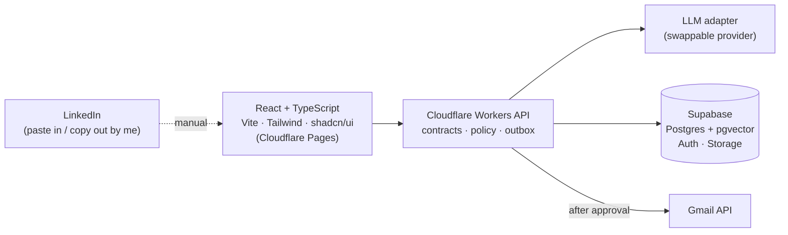

# Echo — AI Communication Twin

A private assistant for my job search. Recruiter, referral and hiring messages from **Gmail** and **LinkedIn** land in one dashboard with a reply already drafted, in my voice and only saying true things about me. I edit if needed, approve, and send. No more copying every message into ChatGPT, and no more leaving people hanging.

> **Status: planning.** The spec and architecture are in place; implementation starts after the open review items in [`docs/GRILL.md`](docs/GRILL.md) are settled.

## What it does

- **Inbox & Approvals.** Messages with AI-drafted replies. Change tone or length, edit, then approve. Gmail sends only after approval; LinkedIn replies are copied and sent by me.
- **Outreach Studio.** Paste a job description and contact, get a referral request, recruiter intro or follow-up.
- **Knowledge Base.** Resumes, verified skills, projects and example messages. Every claim in a draft comes from here.
- **Jobs & Contacts.** A light job-search CRM: who I contacted, what was sent, what's next.
- **Daily Digest.** What was drafted, approved, sent, failed, and what needs a follow-up.

## Guardrails

- **Nothing is sent without my approval.** Each approval covers one exact version of the draft.
- **No LinkedIn automation.** LinkedIn's developer access doesn't allow sending replies, so Echo never scrapes, runs bots, or sends DMs. LinkedIn is copy-and-paste only.
- **No invented facts.** Salary, availability and accepting interviews or offers are always my call.
- **No real messages, tokens or personal data** in the repo, logs or tests.

## Architecture



The backend's policy layer (not the model) decides what's allowed. A send queue with idempotency keys guarantees one email per approval. Full details: [`docs/ARCHITECTURE.md`](docs/ARCHITECTURE.md).

## Roadmap

| Milestone | Scope | Status |
|---|---|---|
| 0 — Foundation | Design system, contracts, database schema, decisions | Planning |
| 1 — Knowledge Base + Outreach Studio | Profile and resumes, JD/contact intake, drafting, edit/copy, LinkedIn manual sends, job CRM | — |
| 2 — Gmail outbound | OAuth `gmail.send`, approval, outbox, idempotent sending | — |
| 3 — Gmail inbox | Read threads, classify, draft replies in-thread | — |
| 4 — Personalization + RAG | Style learning from edits, embeddings, eval set | — |
| 5 — CRM + Digests | Reminders, response tracking, daily summary | — |
| 6 — More integrations | Slack notifications, low-risk templates | — |
| 7 — Hardening | E2E suite, CI/CD, monitoring, deployment | — |

## Repository layout (planned)

```
echo/
├── apps/web/            # React UI
├── workers/api/         # Cloudflare Workers backend
├── packages/
│   ├── contracts/       # shared Zod schemas
│   ├── core/            # domain rules + policy engine
│   ├── ai/              # model adapter, prompts, evals
│   └── connectors/      # Gmail and future providers
├── supabase/            # migrations + synthetic seed data
├── evals/               # redacted fixtures
├── docs/                # PRD, architecture, decisions, review, tasks, mockups
├── AGENTS.md            # rules for coding agents
└── CLAUDE.md            # Claude Code instructions
```

Today only `docs/`, `AGENTS.md`, `CLAUDE.md` and this README exist. Code folders are created as each milestone needs them.

## Docs

| File | What's in it |
|---|---|
| [`docs/PRD.md`](docs/PRD.md) | Product requirements: problem, features, data model, APIs, roadmap, test plan |
| [`docs/ARCHITECTURE.md`](docs/ARCHITECTURE.md) | Components, flows, state machine, environments |
| [`docs/DECISIONS.md`](docs/DECISIONS.md) | Decisions with reasons |
| [`docs/ROAST.md`](docs/ROAST.md) | Open review items, with recommendations |
| [`docs/GRILL.md`](docs/GRILL.md) | One question per review item, with answers |
| [`docs/tasks/`](docs/tasks/) | Work tickets |
| [`docs/assets/`](docs/assets/) | Concept mockups (direction only, not a working app) |

## History

The first commit is the original build kit generated with ChatGPT, unchanged. Later commits show how the plan was reviewed and adapted. Built with Claude Code.

## Running locally

Not yet. Setup instructions arrive with Milestone 0.
