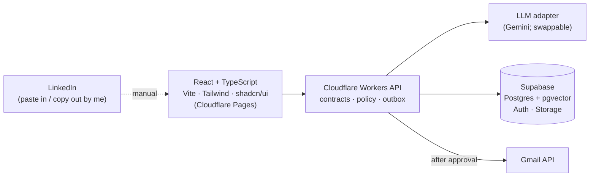

# Echo — AI Communication Twin

[](https://github.com/Pranjal0211/echo/actions/workflows/ci.yml)

A private assistant for my job search. Recruiter, referral and hiring messages from **Gmail** and **LinkedIn** land in one dashboard with a reply already drafted, in my voice and only saying true things about me. I edit if needed, approve, and send. No more copying every message into ChatGPT, and no more leaving people hanging.

> **Status: Milestone 0 working, Milestone 1 in progress.** Paste a message → get a draft in your voice → edit → copy, with a "waiting on you" inbox, and a Knowledge Base that turns your resume into facts you approve. Drafts come from Google Gemini (free tier) with your key, or a deterministic fake model without one. Data can live in a local Supabase (Postgres). No real sends yet.


## What works today (Milestone 0)

- **Paste a message** from LinkedIn or Gmail; it lands in the inbox as *waiting on you*.
- **Inbox sorted by who's waited longest**, with age badges that turn amber after 24h and red after 48h.
- **Draft a reply** by picking what you want to say (interested, need details, not now, decline, thanks, follow up), tone, length and extra instructions.
- **Only you decide:** questions about availability, salary, relocation, start date or visa are flagged, left as `[placeholders]`, and copying is blocked until you fill them in.
- **Grounded in your profile:** only verified facts reach the model; sensitive ones need an opt-in; invented fact references are dropped with a warning.
- **LinkedIn:** Copy for LinkedIn → Mark as sent manually, which moves the thread to *waiting on them*. There is no send button for LinkedIn.
- **Gmail:** shows the recipient and subject; Approve & Send is visible but disabled until Milestone 2.
- **Edits are versioned:** each edit is a new version, and stale edits are rejected.

### Knowledge Base (Milestone 1)

- **Paste your resume** and Gemini suggests short facts, one claim each. The resume text is used once and never saved.
- **You approve every suggestion** before a draft can use it. Suggestions holding email addresses, phone numbers or links are dropped.
- **Salary, visa and notice period** are always marked *ask every time*, so drafts leave them out unless you include them.
- **Edit, re-categorise or delete** any fact, or type your own (yours start approved).
- **Your voice:** style notes and real messages you've sent, which go into every draft prompt.

## What it does

- **Inbox & Approvals.** Messages with AI-drafted replies. Change tone or length, edit, then approve. Gmail sends only after approval; LinkedIn replies are copied and sent by me.
- **Outreach Studio.** Paste a job description and contact, get a referral request, recruiter intro or follow-up.
- **Knowledge Base.** Resumes, verified skills, projects and example messages. Every claim in a draft comes from here.
- **Jobs & Contacts.** A light job-search CRM: who I contacted, what was sent, what's next.
- **Daily Digest.** What was drafted, approved, sent, failed, and what needs a follow-up.

## Guardrails

- **Nothing is sent without my approval.** Each approval covers one exact version of the draft.
- **No LinkedIn automation.** LinkedIn's developer access doesn't allow sending replies, so Echo never scrapes, runs bots, or sends DMs. LinkedIn is copy-and-paste only.
- **No invented facts.** Salary, availability and accepting interviews or offers are always my call.
- **No real messages, tokens or personal data** in the repo, logs or tests.

## Architecture



The backend's policy layer (not the model) decides what's allowed. A send queue with idempotency keys guarantees one email per approval. Full details: [`docs/ARCHITECTURE.md`](docs/ARCHITECTURE.md).

## Roadmap

| Milestone | Scope | Status |
|---|---|---|
| 0 — Foundation | Contracts, core rules, model adapter, Worker API, web app; one working paste → draft → copy path | ✅ First slice working |
| 1 — Knowledge Base + Outreach Studio | Profile and resumes, JD/contact intake, drafting, edit/copy, LinkedIn manual sends, job CRM | 🚧 Postgres storage and Knowledge Base done; Outreach Studio next |
| 2 — Gmail outbound | OAuth `gmail.send`, approval, outbox, idempotent sending | — |
| 3 — Gmail inbox | Read threads, classify, draft replies in-thread | — |
| 4 — Personalization + RAG | Style learning from edits, embeddings, eval set | — |
| 5 — CRM + Digests | Reminders, response tracking, daily summary | — |
| 6 — More integrations | Slack notifications, low-risk templates | — |
| 7 — Hardening | E2E suite, CI/CD, monitoring, deployment | — |

## Repository layout (planned)

```
echo/
├── apps/web/            # React UI
├── workers/api/         # Cloudflare Workers backend
├── packages/
│   ├── contracts/       # shared Zod schemas
│   ├── core/            # domain rules + policy engine
│   ├── ai/              # model adapter, prompts, evals
│   └── connectors/      # Gmail and future providers
├── supabase/            # migrations + synthetic seed data
├── evals/               # redacted fixtures
├── docs/                # PRD, architecture, decisions, review, tasks, mockups
├── AGENTS.md            # rules for coding agents
└── CLAUDE.md            # Claude Code instructions
```

Today `packages/contracts`, `packages/core`, `packages/ai`, `workers/api`, `apps/web` and `supabase/` exist. `packages/connectors` and `evals/` are created when their milestone needs them.

## Docs

| File | What's in it |
|---|---|
| [`docs/PRD.md`](docs/PRD.md) | Product requirements: problem, features, data model, APIs, roadmap, test plan |
| [`docs/ARCHITECTURE.md`](docs/ARCHITECTURE.md) | Components, flows, state machine, environments |
| [`docs/DECISIONS.md`](docs/DECISIONS.md) | Decisions with reasons |
| [`docs/ROAST.md`](docs/ROAST.md) | Open review items, with recommendations |
| [`docs/GRILL.md`](docs/GRILL.md) | One question per review item, with answers |
| [`docs/tasks/`](docs/tasks/) | Work tickets |
| [`docs/assets/`](docs/assets/) | Concept mockups (direction only, not a working app) |

## History

The first commit is the original build kit generated with ChatGPT, unchanged. Later commits show how the plan was reviewed and adapted. Built with Claude Code.

## Running locally

Needs Node 24 (see `.nvmrc`). No accounts or API keys.

```bash
npm install
npm run dev        # API on http://localhost:8787, web app on http://localhost:5173
```

Open http://localhost:5173. Data is synthetic and resets when the API restarts, unless you keep it in Supabase (below).

### Real AI drafts with Gemini (free)

Without a key, drafts come from a deterministic fake model (the panel says "Drafted by the fake model"). To use Google Gemini:

1. Create a free API key at [Google AI Studio](https://aistudio.google.com/apikey).
2. Copy `workers/api/.dev.vars.example` to `workers/api/.dev.vars` (git-ignored) and paste the key after `GEMINI_API_KEY=`.
3. Restart `npm run dev`. The reply panel now says "Drafted by gemini-3.8-flash", or "gemini-3.5-flash-lite" when 3.8 is busy and Echo falls back.

On the free tier, Google may use what you send to improve its products, and human reviewers may read it ([ADR-019](docs/DECISIONS.md)). Tests never call Gemini.

### Keep your data in a local Supabase (free, no account)

Needs Docker running. Postgres runs on your machine; nothing goes to the cloud ([ADR-020](docs/DECISIONS.md)).

```bash
npm run db:start   # Postgres + REST API in Docker; applies supabase/migrations
npm run db:env     # writes the local URL and secret key into workers/api/.dev.vars
npm run db:seed    # optional: the synthetic demo data
```

Restart `npm run dev`; drafts, edits and sent replies now survive restarts. `npm run db:reset` wipes the database and reseeds it, and Supabase Studio at http://127.0.0.1:54323 shows the tables. Every table has row-level security, so only the API (holding the secret key) can read it.

```bash
npm test           # 164 tests across contracts, core, ai, api and web
npm run test:db    # the store tests again, against the local Supabase
npm run typecheck
npm run build
```

The same checks run on GitHub for every pull request ([`.github/workflows/ci.yml`](.github/workflows/ci.yml)), with no secrets, plus the database tests against a throwaway Supabase.

| Package | What's in it |
|---|---|
| `packages/contracts` | Zod schemas shared by API and web: conversations, drafts, profile facts, requests, errors |
| `packages/core` | Draft lifecycle (exact-version edits, LinkedIn copy-only), policy (verified facts, opt-outs, grounding), waiting-on-me ordering |
| `packages/ai` | `DraftModel` and `FactSuggester` adapter interfaces, Gemini adapter, prompt builders that treat messages and resumes as data, decision detector, fact clean-up, deterministic fake model |
| `workers/api` | Cloudflare Worker (Hono): inbox, paste, generate, edit, copy, mark-sent, Knowledge Base; storage in memory or Supabase |
| `supabase` | Postgres schema (migrations) with row-level security on every table, and local Supabase config |
| `apps/web` | React + Vite + Tailwind: inbox, paste form, reply panel, Knowledge Base |

## More of my agentic AI projects

| Project | What it is | Built with |
|---|---|---|
| **[Echo](https://github.com/Pranjal0211/echo)** (this repo) | AI communication twin: drafts job-search replies for Gmail and LinkedIn in my voice; nothing sends without my approval | React, TypeScript, Cloudflare Workers, Supabase, LLM adapter |
| **[agent-crew](https://github.com/Pranjal0211/agent-crew)** | My AI build crew: Claude Code agents (planner, builder, tester, designer) plus a `/round` team-lead skill that picks tasks, builds them, checks them in a real browser and opens PRs on other projects | Claude Code subagents, skills, Playwright |
| **[agent-office](https://github.com/Pranjal0211/agent-office)** | A virtual office where my AI agents work as employees: a live crew board showing who each agent is, what it's doing now, and what's next. Built and improved by agent-crew | HTML, CSS, JavaScript |
| Claude Agent SDK series | Hands-on learning series building agents with the Claude Agent SDK (in progress, not published yet) | TypeScript, Claude Agent SDK |

## License

[MIT](LICENSE) © 2026 Pranjal Sharma
