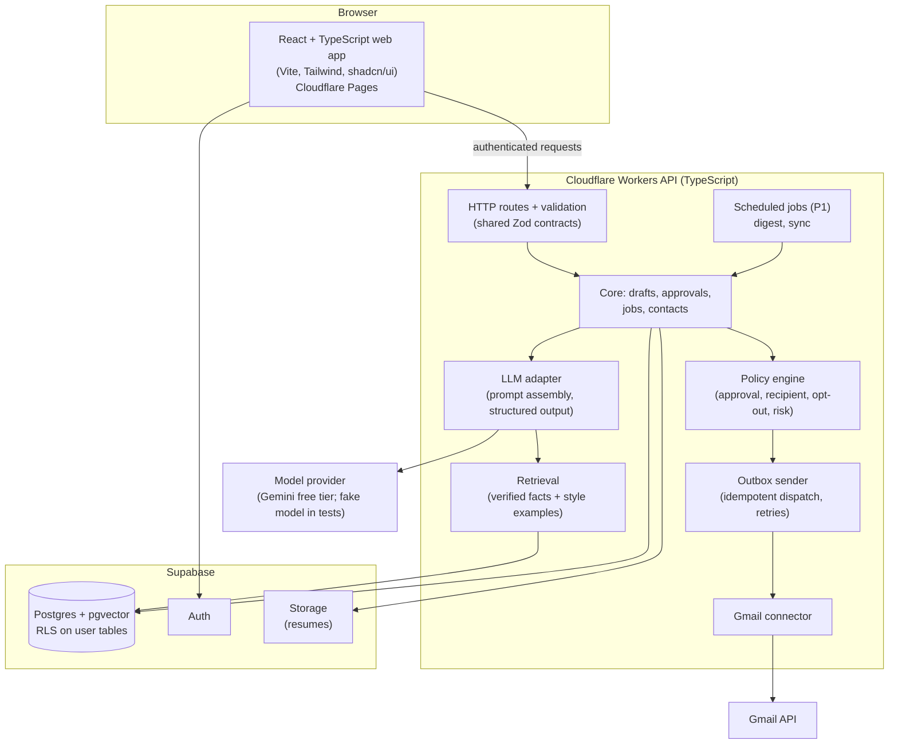
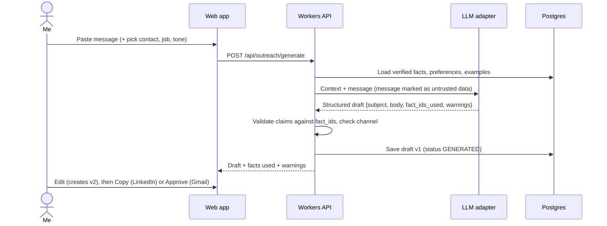
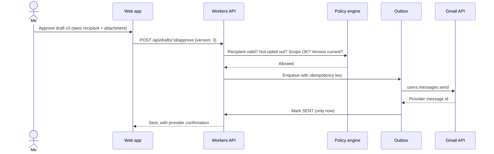
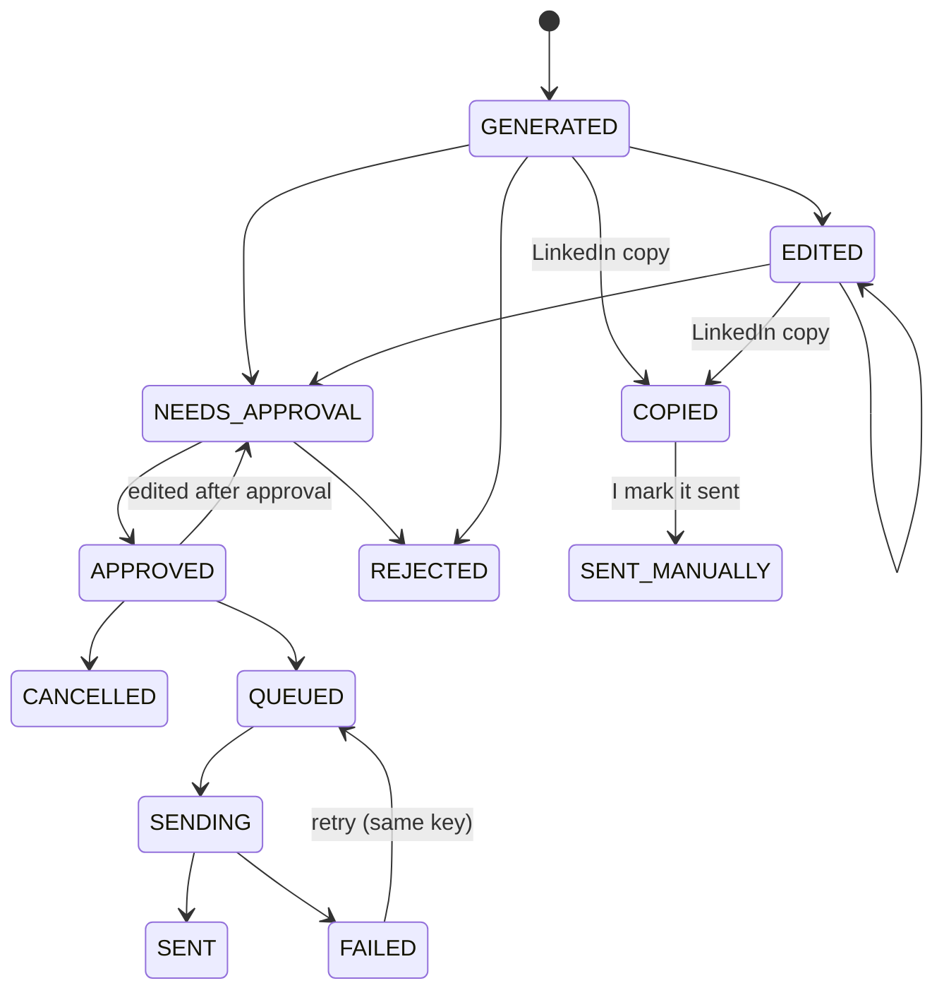

# Echo — Architecture

How the pieces described in `PRD.md` §8 fit together. Choices and reasons are in `DECISIONS.md`.

## System overview

LinkedIn has no box on purpose: LinkedIn messages enter as pasted text and leave by the owner copying the reply. Echo never talks to LinkedIn.

## Components

| Component | Lives in | Responsibility |
|---|---|---|
| Web app | `apps/web` | Inbox, approvals, Outreach Studio, jobs, contacts, knowledge base, digest, settings |
| API | `workers/api` | Hono routes, request validation, error mapping; auth and rate limits arrive with Supabase (Milestone 1) |
| Contracts | `packages/contracts` | Zod schemas shared by web and API (single source of request/response types) |
| Core | `packages/core` | Domain rules: draft versions, approval state, CRM records |
| Policy engine | `packages/core` | Decides whether an action is allowed; the model never decides this |
| LLM adapter | `packages/ai` | Builds prompts, calls the model, parses and validates structured output; swappable provider |
| Connectors | `packages/connectors` | Gmail now; any future provider behind the same message interface |
| Storage | `workers/api/src/store.ts` now, `supabase/migrations` from Milestone 1 | `EchoStore` interface; in-memory synthetic data in Milestone 0, Postgres later. Source of truth for drafts and send status |

## Flow 1 — Draft a reply (Milestone 1, pasted message)

## Flow 2 — Approve and send via Gmail (Milestone 2)

If anything is edited after approval, the approval is invalid and the draft goes back to `NEEDS_APPROVAL`. A repeated click reuses the same idempotency key, so the email still goes out only once.

## Draft state machine

## Data model (initial)

Tables from PRD §8.4: `users`, `connected_accounts`, `contacts`, `jobs`, `applications`, `conversations`, `messages`, `drafts`, `approvals`, `outbox`, `documents`, `profile_facts`, `style_examples`, `activity_events`. Every user-owned table has row-level security. The database, not the button click, is the source of truth for send status.

## Environments and flags

| Environment | Model | Gmail | Data |
|---|---|---|---|
| Local | Fake model by default; Gemini when `ECHO_MODEL=gemini` and `GEMINI_API_KEY` are in `workers/api/.dev.vars` | Fake connector | Synthetic seed |
| Staging | Real model | Test Google account only | Synthetic + test recipients |
| Personal production | Real model | My account, sends only after approval | Mine |

Flags: `GMAIL_READ_ENABLED`, `GMAIL_SEND_ENABLED`, `LINKEDIN_MANUAL_ONLY=true`, `AUTO_SEND_ENABLED=false`.

## Security notes

- OAuth refresh tokens are encrypted, stored server-side only, never sent to the browser.
- Message bodies and tokens are not logged by default.
- Message, email and job-description text is passed to the model as data, never as instructions; the model cannot grant itself permissions.
- Secrets live in Cloudflare/Supabase environment settings, never in the repo.
