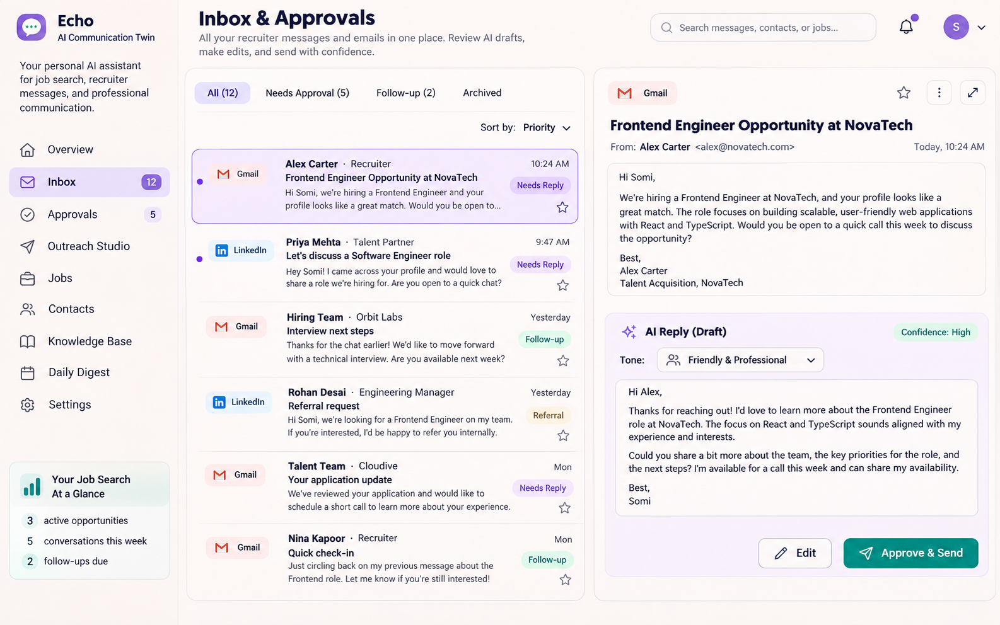
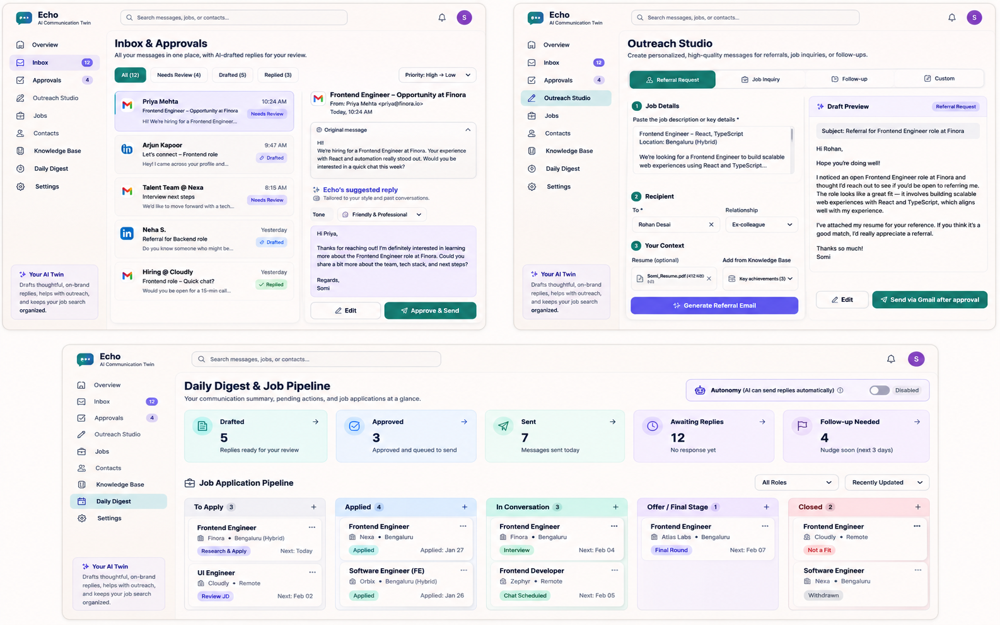
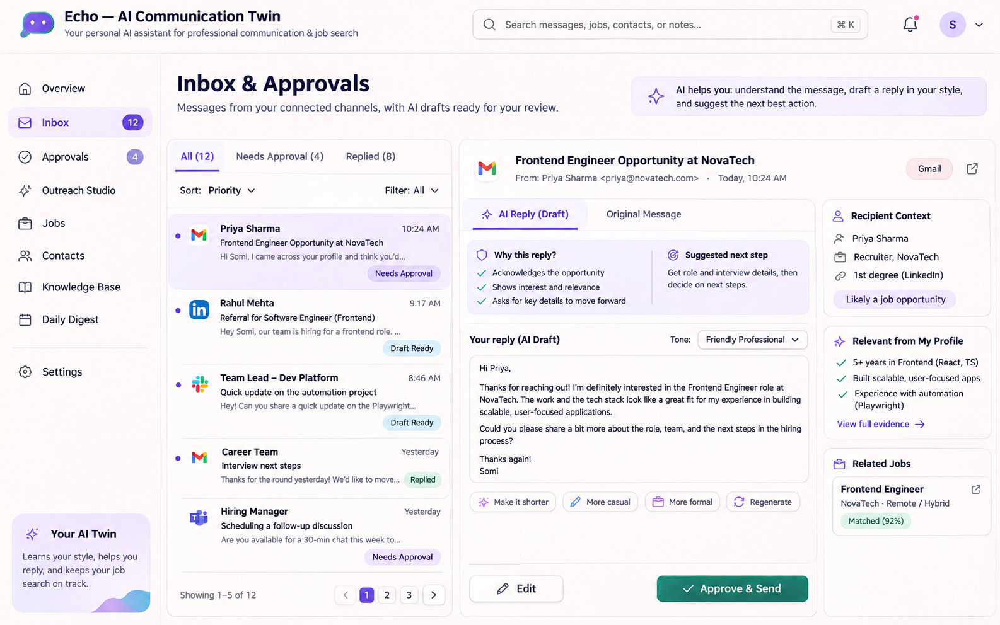

# ECHO — AI Communication Twin

**Product Requirements Document (PRD) + implementation blueprint**  
**Version:** 1.2  
**Date:** 2026-11-08  
**Status:** Accepted baseline. Open review items are tracked in `docs/ROAST.md` and resolved one at a time via `docs/GRILL.md`.  
**Owner:** Pranjal Sharma  
**Builder:** Claude Code (single agent)  
**Initial release:** Private single-user application  

> **North star:** Make professional communication fast, personal, accurate, and accountable. Echo should understand how the user writes, help with job searching, and reduce the friction between receiving a message and sending a thoughtful reply.

> **The pain behind it (owner's words):** recruiter and referral messages on Gmail and LinkedIn get answered late or not at all. Today every reply means copying the message into ChatGPT, getting a draft, and pasting it back. Echo should show those messages in one dashboard with a draft ready, so the owner only has to approve and send.

### Changes from v1.0
- Built by Claude Code alone; the Codex / ChatGPT / integrator split in section 13 is replaced.
- Input is pasted text (and Gmail sync later). No screenshot capture.
- LinkedIn support is optional: copy-paste assist only, because LinkedIn's developer access doesn't allow sending replies.
- Stack, architecture, milestones and guardrails are unchanged from v1.0.

### Changes in v1.2 (2026-11-09, owner accepted the review recommendations in `GRILL.md`)
- Milestone 0 ends with one working paste → draft → copy path on a fake model (R8).
- Milestone 1 also replies to pasted messages and tracks who is waiting on whom (R1, R2), and uses style notes and examples in prompts from day one (R4).
- Success metrics gain concrete targets (R5). FR-06 is labelled Milestone 2 (R7).
- Copying is blocked while a draft still contains `[placeholders]` for the owner's decisions.

## 1. Executive summary

Echo is a personal AI communication assistant and job-search copilot. It drafts replies, proposes outreach to recruiters and potential referrers, uses a verified professional knowledge base, tracks communications, and produces a daily digest. Initially it will support **Gmail with official OAuth/API integration** and **LinkedIn-assisted workflows through manual capture and copy-to-send**. Slack and Microsoft Teams are later integrations, subject to authorization and workspace restrictions.

Echo is also an **AI engineering portfolio project**: it must demonstrate LLM integration, tool use, retrieval-augmented generation (RAG), policy-controlled action execution, OAuth, data modeling, security, evaluations, observability, and production engineering.

### 1.1 Product decisions already made

| Area | Decision |
|---|---|
| Primary problem | Delayed replies and hesitation around wording, particularly during a job search |
| Target channels | Gmail (automated integration) and LinkedIn (assisted, manual sending) |
| Primary use cases | Inbound replies, referral requests, recruiter outreach, follow-ups, job tracking |
| Initial autonomy | **Every outgoing message requires explicit user approval** |
| Future autonomy | Narrow, opted-in low-risk templates; important messages always require approval |
| Personalization | Preferences + approved examples + feedback on edits + later RAG |
| Initial UX | Responsive web dashboard; later optional browser share flow |
| User scope | Private single-user MVP; potential SaaS later |
| Stack | React + TypeScript; Cloudflare Workers API; Supabase PostgreSQL + pgvector |
| Initial model | Hosted open-weight instruct model via configurable provider adapter |
| Hosting goal | Free-tier personal MVP where quotas permit; no guarantee of perpetual $0 |
| LinkedIn constraint | No unsupported scraping, DM automation, or unofficial API workarounds |

### 1.2 What Echo is not

Echo is **not** an unsolicited bulk-email system, an automated LinkedIn bot, an unsupervised job-application spammer, or a model that invents credentials or professional accomplishments. It cannot independently accept interviews, agree to compensation, disclose sensitive information, or promise availability without a deliberate user decision.

## 2. Problem, goals, and success

### 2.1 User problem

Composing professional messages can consume disproportionate time and emotional effort. This is especially costly in job searching, where recruiters, referrals, hiring managers, and interviews require timely responses. The user wants writing that sounds **human and personal**, not generic AI prose, and wants a reliable record of what was sent.

### 2.2 Primary jobs to be done

1. **Reply:** “When someone emails me, give me a relevant, natural draft that I can approve in seconds.”
2. **Reach out:** “When I find a job, write a tailored referral request or recruiter email from my resume and the job description.”
3. **Remember:** “Know my real skills, prior conversations, preferences, and the relationship I have with the recipient.”
4. **Track:** “Show who I contacted, what was sent, who replied, and when to follow up.”
5. **Summarize:** “Tell me what happened today, what still needs approval, and what needs attention.”

### 2.3 Business and learning goals

- Deliver an actually usable single-user assistant, not a demo-only chatbot.
- Reduce time to prepare and send high-quality messages, measured from real use.
- Improve the fraction of drafts approved with little editing.
- Build demonstrable AI-native software engineering skills: retrieval, function/tool calling, evaluation, policy guardrails, connectors, deployment, CI/CD, privacy, and cost management.
- Preserve a plausible route toward commercialization without making it an MVP requirement.

### 2.4 Measurable success metrics

| Metric | Definition | Initial target / policy |
|---|---|---|
| Reply debt | Threads waiting on me for more than 48h | **0 on most days** |
| Reply time | Median time to reply to a recruiter or referral message | **Under 24h** |
| Time to draft | Opening a message to having a reply ready | **Under 60 seconds** |
| Light-edit rate | Drafts sent with only light edits | **70% or more** |
| Draft acceptance rate | Approved drafts / generated drafts | Collect baseline; improve by iteration |
| Edit effort | Amount of change from AI draft to approved draft | Track; no fabricated benchmark |
| Factual accuracy | Checked grounded claims / checked factual claims | No known false professional claims |
| Time to ready-to-send | Message selection to approved content | Measure baseline and improvements |
| Confirmed send rate | Provider-confirmed sent / attempted sends | Monitor; show failures transparently |
| Duplicate sends | Duplicate delivery attempts for one approval | Zero by design |
| Outreach response rate | Replies / messages successfully sent | Measure, avoid optimizing for spam |
| Cost per draft | Provider/model spend / drafts generated | Visible; alert before free quota exhaustion |
| Style quality | User rating on tone and naturalness | Improve via feedback/evaluation set |

## 3. Personas and access boundaries

**Primary persona:** A software engineer building an AI profile and actively job searching. They can use React, TypeScript, and test automation and want practical exposure to backend and AI systems. They prefer brief, warm, direct language and want the final draft to sound like themselves.

**Secondary future persona:** Another individual professional managing their own communication. Multi-tenancy, billing, and organization administration are out of scope for the initial product.

**Access principle:** The user owns their accounts and data. Every integration must request the smallest useful permission set, be revocable, and show whether an action was suggested, approved, attempted, or actually completed.

## 4. UX and reference screens

The interface should feel like an AI inbox + lightweight job-search CRM: calm, clear, fast, desktop-first with a usable mobile review flow. Use warm neutrals, accessible typography, restrained purple/teal accents, and obvious approval states. Keep drafting and recipient context next to the original message.

### 4.1 Inbox & Approvals reference



**Important:** This is a concept mockup, not a working app. A LinkedIn item can appear in a unified list only if the user imported it or the product later gains approved integration rights. A LinkedIn draft must say **Copy for LinkedIn**, never **Approve & Send**.

### 4.2 Outreach Studio and job pipeline reference



### 4.3 Contextual draft reference



### 4.4 Navigation

| Screen | Responsibility |
|---|---|
| Overview | Priorities, pending replies, job-search pulse |
| Inbox | Gmail threads and manually imported external messages |
| Approvals | Review/edit/reject/approve pending messages |
| Outreach Studio | Referral, recruiter, job inquiry, follow-up, and custom drafts |
| Jobs | Job pipeline, job descriptions, resumes used, next actions |
| Contacts | Recipients, relationship history, verified addresses |
| Knowledge Base | Resumes, projects, accomplishments, communication examples |
| Daily Digest | Sent vs. drafted vs. approved, responses, reminders, failures |
| Settings | Connected accounts, permissions, autonomy, retention, models |

### 4.5 User flows

**Flow A — Gmail inbound reply**

1. User connects Gmail with the necessary OAuth scopes.
2. Echo syncs selected messages/threads and identifies a recruiter email.
3. The model classifies intent; backend retrieves relevant user facts and relationship context.
4. Echo generates a draft and explains the source of important claims.
5. User edits, approves, or rejects the exact draft version.
6. Backend sends using Gmail with the original thread metadata and logs the provider response.
7. UI shows **Sent** only after successful provider confirmation.

**Flow B — LinkedIn referral request**

1. User pastes an accessible job description and relevant LinkedIn contact/profile details.
2. Echo retrieves matching skills and verified experience from the Knowledge Base.
3. Echo drafts a concise, personal referral message.
4. User copies it and sends manually through LinkedIn.
5. Echo lets the user mark it **Sent manually** and records a suggested follow-up date.

**Flow C — Recruiter email from job description**

1. User pastes a JD, company, recipient name, and verified email address.
2. Echo suggests the relevant resume version and supporting achievements.
3. AI generates subject and body, referencing only verified facts.
4. User reviews recipient, message, resume attachment, and tone.
5. After explicit approval, Gmail API sends the new email.
6. CRM records contact, job, send confirmation, and follow-up status.

**Flow D — Daily digest**

1. Scheduler or explicit user action gathers activity records.
2. Digest reports drafts created, approvals, Gmail sends confirmed, LinkedIn manually marked sends, failures, replies, and upcoming follow-ups.
3. User sees actionable items and can navigate to each underlying record.

## 5. Feature requirements and priorities

**P0:** Needed for the first useful private release. **P1:** Near-term expansion. **P2:** Advanced/conditional.

| ID | Feature | Priority | Acceptance criteria |
|---|---|---|---|
| FR-01 | User authentication | P0 | Authenticated users only; private single-user access |
| FR-02 | Professional Knowledge Base | P0 | Resume, projects, achievements and preferences stored and editable |
| FR-03 | JD and contact intake | P0 | Paste text, job URL metadata and verified recipient fields |
| FR-04 | AI reply and outreach generation | P0 | Editable grounded drafts; no automatic sending |
| FR-05 | Manual LinkedIn assistant | P0 | Copy message, open LinkedIn, mark manually sent |
| FR-06 | Gmail sending | P0 — Milestone 2 | Explicit approval; correct recipient and attachments; provider confirmation |
| FR-07 | Contact and job tracking | P0 | Save jobs, recipients, statuses and follow-up dates |
| FR-08 | Action audit log | P0 | Track user decision, draft version and send outcome |
| FR-09 | Gmail inbox/thread reading | P1 | Authorized thread retrieval and contextual replies |
| FR-10 | Gmail change notifications | P1 | Reliable incremental sync, retries and deduplication |
| FR-11 | Style feedback loop | P1 | Store user-approved edits and preferences |
| FR-12 | RAG using pgvector | P1 | Retrieve relevant profile/context, not unrelated history |
| FR-13 | Scheduled digest and reminders | P1 | Accurate daily report, clear unsent/failed distinctions |
| FR-14 | Slack notifications/approvals | P1 | Workspace-approved, no content leak to employer workspace |
| FR-15 | Calendar read/scheduling suggestions | P1 | Availability only after authorization; no invented slots |
| FR-16 | Model evaluation dashboard | P1 | Replay examples and compare provider quality/cost |
| FR-17 | Selective automatic sends | P2 | Explicit opt-in rules, independent policy checks, kill switch |
| FR-18 | Teams connector | P2 | Delegated access and tenant approval where necessary |
| FR-19 | MCP server | P2 | Safe read/draft tools; sending remains policy-gated |
| FR-20 | Multi-user SaaS | P2 | Separate security, verification and billing workstreams |

## 6. Detailed functional specifications

### 6.1 Smart Inbox and approvals

- Display channel, sender, subject, timestamp, original message, relevant context, and proposed draft.
- Distinguish: `new`, `draft_ready`, `needs_approval`, `approved`, `sending`, `sent`, `failed`, `rejected`, `archived`.
- Let users rewrite, change tone/length, regenerate, edit manually, or reject.
- Freeze a **specific version** at approval; edits after approval invalidate approval.
- Show the recipient and reply-to/thread context before sending.
- Provide useful error and retry states without duplicate deliveries.
- Show whether a LinkedIn item was imported manually and whether its send status was user-reported.

### 6.2 Personality and learning system

**Profile memory:** Style preferences (short, warm, natural, direct), accepted sign-offs, target roles, verified technical skills.  
**Relationship memory:** Recruiter, hiring manager, former colleague, friend, and past interactions.  
**Communication memory:** User-approved samples, specific corrections, disliked phrases, accepted draft patterns.

Workflow: `Generate → Edit → Approve → Compute differences → Extract a candidate preference → User can inspect/delete preference → Use in later prompts`.

Prefer structured style instructions and retrieval over initial fine-tuning. Retain examples only with consent. Never infer unverified background from a job description.

### 6.3 Knowledge Base

Store professional summary, dated positions, project highlights, validated achievements, technologies, education/certifications, target job types, location preferences, resumes, portfolio links, and writing examples. All generated factual claims must be grounded in these sources. Sensitive details (e.g., work authorization, pay, private contact details) should be **opt-in per use** and never inserted solely because they exist in the profile.

Documents can be manually tagged with `role_type`, `skills`, `last_updated`, `verified`, `source`, and `resume_version`. Resume selection should be explicit at first; suggestions can be added later.

### 6.4 Outreach Studio

**Modes:** Referral request, recruiter introduction, application inquiry, follow-up, custom networking.  
**Inputs:** Job text/URL, company, recipient identity, verified email or LinkedIn profile, relationship, chosen resume, tone, desired length, and delivery channel.  
**Outputs:** Suggested subject (email), draft, claims used, attachment selection, and recommended next action.

For multi-recipient outreach, create a separate individualized draft per recipient. Do not auto-guess email addresses, auto-send a bulk list, repeatedly contact nonresponders, or bypass unsubscribe/opt-out requests. Log every sent action and stop proposed follow-ups when a relevant reply arrives.

### 6.5 Jobs and Contacts CRM

**Job fields:** `company`, `title`, `location`, `url`, `description`, `source`, `status`, `application_date`, `resume_id`, `next_action`, `next_action_at`.  
**Contact fields:** `name`, `company`, `relationship`, `verified_email`, `linkedIn_url`, `opt_out`, `last_contacted_at`, `notes`.  
**Stages:** `saved → preparing → applied/contacted → interviewing → offer → closed`.

Before any outreach, check past messages, duplicate contacts, opted-out contacts, recipient validity, and whether the job is relevant. Never present an old/supplied posting as verified open without a current source.

### 6.6 Daily digest

Digest fields: drafts, approved, confirmed Gmail sent, manually marked LinkedIn sent, awaiting approval, incoming responses, failed sends, contacts contacted, jobs updated, follow-ups due. Each metric must have clear provenance and link back to details. The digest can be generated on demand first; scheduling is P1.

### 6.7 Autonomy policy

**Initial default:** All sends need approval.  
**Potential future allowances:** Exact-match, pre-approved low-risk acknowledgement templates and narrow follow-up templates after evaluation.  
**Always require approval:** Job offers, salary discussions, interview acceptances/scheduling commitments, legal/medical/financial topics, sensitive data, and any ambiguous recipient or context.  
**Never permitted:** Unauthorized LinkedIn automation, fabricated facts, credential sharing, unsolicited bulk sending.

The **backend policy layer**, not the LLM, enforces all constraints. Include a kill switch and a per-integration disconnect control.

## 7. Platform integrations and permissions

| Integration | Read | Send/action | Constraints / approach |
|---|---|---|---|
| Gmail | Official API | Official API | OAuth consent, restricted scopes for read/compose |
| LinkedIn | General personal inbox API not open | General DM automation restricted | Manual user-provided text + copy-to-send; partner-only if approved |
| Slack | Authorized channels/events | Messaging APIs | Workspace installation, scopes, employer policies |
| Microsoft Teams | Microsoft Graph | Delegated chat send where allowed | Tenant admin and permission limitations |
| Google Calendar | Authorized events | Create/update if authorized | Narrow calendar scopes and availability confirmation |
| Google Contacts | People API | Authorized contact updates | Avoid broad collection without need |
| GitHub | Public project evidence or consented data | Optional read | Project facts should be reviewed before use |
| Job boards | Public/approved feeds or user-supplied URLs | No automatic apply in MVP | Terms and data availability vary |

### 7.1 Gmail API specifics

Read: `users.messages.list`, `users.messages.get`, `users.threads.get`.  
Draft: `users.drafts.create`, `users.drafts.send` where needed.  
Send: `users.messages.send`.  
Incremental sync: `users.watch` plus `users.history.list` with Google Cloud Pub/Sub, or an MVP user-triggered sync / bounded polling path.

OAuth scope plan:
- **Outbound-only MVP:** `https://www.googleapis.com/auth/gmail.send`.
- **Inbox P1:** Add `https://www.googleapis.com/auth/gmail.readonly` only when needed.
- **Optional Gmail-managed drafts:** `https://www.googleapis.com/auth/gmail.compose` if required.

`gmail.readonly` and `gmail.compose` are restricted scopes; `gmail.send` is sensitive. Google OAuth app verification and potentially an independent security assessment can become relevant for publicly deployed applications storing restricted-scope data. Development/test-mode refresh token behavior must be accounted for. Store refresh tokens encrypted; never place them in frontend code.

### 7.2 LinkedIn specifics

Build these safe capabilities:
- Paste selected message text, public job description and manually provided recipient context.
- Draft and copy to clipboard.
- Open the supplied LinkedIn URL in a new tab.
- Mark as manually sent; enter follow-up and outcome.

Do **not** promise unrestricted inbox synchronization, message sending through a personal account, browser scraping, automated connection requests, or Playwright-based bot messaging. If LinkedIn later grants formal partner approval, the connector can be added behind the same message abstraction.

### 7.3 Slack: two distinct designs

**Slack as an approval surface:** Post a small notification to an authorized personal/approved workspace with an authenticated link to Echo's approval screen. Advantages: less context-switching. Disadvantages: extra app setup, enterprise privacy risks, potential loss of personal-job-search confidentiality.

**Slack as a source and destination:** Read authorized message events and post through `chat.postMessage` with the approved token/scope. Advantages: unified workflow. Disadvantages: workspace admin approval, channel permission boundaries, bot-vs-user identity semantics, and elevated privacy requirements.

**Recommendation:** Use Slack notifications before two-way Slack messaging; do not relay personal recruiting data to an employer-controlled Slack workspace without explicit authorization.

### 7.4 Teams specifics

Microsoft Graph supports chat messaging with delegated permissions such as `ChatMessage.Send` for supported scenarios; standard user chat sending is not equivalent to unrestricted app-only sending. Organization tenant policies and admin consent may block installation or access. Keep Teams at P2.

### 7.5 Required user access and onboarding

**For MVP:** a reviewed resume, professional accomplishments, style examples user is willing to share, target roles, job description and contact details, app signup, and OAuth authorization when Gmail sending is added. **Later:** broader Gmail inbox scopes, Slack workspace approval, Teams tenant approval, Calendar scopes.

Never request account passwords, personal-session cookies, or raw secrets through chat. Every connector needs a clearly labeled **Connect / Permissions / Disconnect** screen.

## 8. Technical architecture

### 8.1 Proposed runtime architecture

```text
[React / TypeScript web client]
             |
      Authenticated API
             v
[Cloudflare Workers backend]
  |      |       |        \
  |      |       |         \--[Connector adapters: Gmail, Slack later]
  |      |       |
  |      |       +--[Policy engine + outbox + audit]
  |      |
  |      +--[LLM adapter -> Workers AI / other model]
  |               |
  +--[Retrieval / Knowledge Base]
                  |
       [Supabase Postgres + pgvector]
                  |
       [Supabase Storage: resumes]

[Scheduled worker/cron, optional P1]
                  |
          [Digest + sync jobs]
```

**Runtime trade-off:** Cloudflare Workers is a good free-tier TypeScript backend for short API requests and scheduled jobs. A long-running Python/FastAPI server would require a different hosting arrangement. Python is still valuable for local evaluations, benchmarking and optional future services. The architecture is intentionally **model-provider agnostic**.

### 8.2 Component responsibilities

| Component | Responsibilities |
|---|---|
| React UI | Inbox, editor, approval queue, Knowledge Base, outreach studio, CRM, settings |
| Backend API | Auth, validation, business operations, rate limiting, audit, provider calls |
| Connector adapters | Normalize external messages; send only when provider supports it |
| LLM adapter | Prompt assembly, model calls, structured output parsing, model fallback |
| Retrieval | Select verified user facts and relevant approved writing samples |
| Policy engine | Required approval, consent, recipient checks, risk categories, limits |
| Outbox sender | Provider dispatch, idempotency, retries and reconciliation |
| Database | Jobs, contacts, drafts, approval state, facts, activity |
| Object storage | Resumes and other user-provided documents |
| Evaluations | Golden examples, regressions, style/factual scoring, costs |

### 8.3 AI generation workflow

`Intent classification → Load authorized context → Retrieve relevant facts and examples → Generate structured draft → Validate claims/recipient/channel → Apply policy → Show preview → Obtain approval → Execute through provider → Log outcome`.

The LLM must output structured data such as:

```json
{
  "channel": "gmail",
  "purpose": "recruiter_intro",
  "subject": "Interest in Frontend Engineer role",
  "body": "Hi ...",
  "fact_ids_used": ["fact_123", "fact_456"],
  "requires_approval": true,
  "warnings": []
}
```

This is illustrative, **not an executable contract**. Final JSON schema and validations belong in a shared API package. Untrusted source text (email/JD) must be treated as data, not agent instructions. The model cannot grant its own tool permissions.

### 8.4 Data model (initial tables)

| Table | Suggested fields |
|---|---|
| `users` | `id`, `created_at`, `timezone`, `preferences_json` |
| `connected_accounts` | `id`, `user_id`, `provider`, `external_account_id`, `scopes`, `encrypted_token_ref`, `status` |
| `contacts` | `id`, `user_id`, `name`, `company`, `verified_email`, `linkedin_url`, `relationship`, `opt_out` |
| `jobs` | `id`, `user_id`, `company`, `title`, `location`, `source_url`, `description`, `status` |
| `applications` | `id`, `job_id`, `resume_id`, `status`, `applied_at`, `next_action_at` |
| `conversations` | `id`, `provider`, `external_thread_id`, `contact_id`, `import_source` |
| `messages` | `id`, `conversation_id`, `external_message_id`, `direction`, `content`, `occurred_at` |
| `drafts` | `id`, `message_id`, `job_id`, `contact_id`, `channel`, `subject`, `body`, `version`, `status`, `model_id` |
| `approvals` | `id`, `draft_id`, `draft_version`, `user_id`, `decision`, `approved_at` |
| `outbox` | `id`, `approval_id`, `idempotency_key`, `provider`, `status`, `provider_message_id`, `attempt_count` |
| `documents` | `id`, `user_id`, `file_type`, `storage_key`, `resume_version`, `verification_status` |
| `profile_facts` | `id`, `user_id`, `fact`, `source_document_id`, `verified`, `sensitivity` |
| `style_examples` | `id`, `user_id`, `context`, `approved_text`, `embedding`, `consent` |
| `activity_events` | `id`, `actor`, `action`, `entity_type`, `entity_id`, `result`, `timestamp` |

All user-owned tables use **row-level security** (RLS). Preserve unique provider IDs and per-approval idempotency keys. The database is the source of truth for send status; do not infer delivery from the button click alone.

### 8.5 Initial API contracts (suggested)

| Method + route | Behavior | Permission |
|---|---|---|
| `POST /api/outreach/generate` | Generate draft from job/contact/profile context | Authenticated user |
| `GET /api/drafts` | List drafts with filters | Authenticated owner |
| `PATCH /api/drafts/:id` | Edit draft, increment version | Authenticated owner |
| `POST /api/drafts/:id/approve` | Approve specific immutable version | Authenticated owner |
| `POST /api/drafts/:id/send` | Trigger approved send via outbox | Authenticated owner; provider connected |
| `GET /api/activity` | Show actions and confirmed status | Authenticated owner |
| `POST /api/jobs` | Save job and JD | Authenticated owner |
| `POST /api/contacts` | Save verified contact | Authenticated owner |
| `POST /api/documents` | Upload and register resume | Authenticated owner |
| `GET /api/providers/gmail/connect` | Begin Google OAuth | Authenticated owner |
| `GET /api/providers/gmail/callback` | Exchange OAuth code securely | Validated state/PKCE where supported |
| `POST /api/providers/gmail/disconnect` | Revoke/remove integration | Authenticated owner |
| `GET /api/digest` | Current digest | Authenticated owner |

Use shared Zod schemas (or equivalent) for request/response validation. CSRF/state protections apply to OAuth and other sensitive flows. Do not let the browser call Gmail with refresh tokens.

### 8.6 Draft and send state machine

```text
GENERATED -> EDITED -> NEEDS_APPROVAL -> APPROVED -> QUEUED -> SENDING -> SENT
     |          |              |              |                      |
     +--------> REJECTED <-----+              |                   FAILED
                                \             |                      |
                                 -> CANCELLED <+                  RETRYABLE
```

Send only when `approved_draft_version == current_draft_version`, the recipient is valid, the provider has adequate scopes, the message is not blocked by policy, and the idempotency key is unused. Retry logic must reconcile provider-side success when the network response is lost.

### 8.7 Dev and deployment environments

- **Local:** Fake connectors and seeded synthetic data; no real email sending by default.
- **Staging:** Dedicated test account, test OAuth client where possible, sample resume, clearly marked test recipients.
- **Production personal:** Private authenticated dashboard, least-privilege account connection, real Gmail sends only after explicit approval.
- **Feature flags:** `GMAIL_READ_ENABLED`, `GMAIL_SEND_ENABLED`, `LINKEDIN_MANUAL_ONLY`, `AUTO_SEND_ENABLED=false`.

## 9. Infrastructure and cost analysis

### 9.1 General principle

**Open-source weights ≠ free hosted inference.** An LLM may be free to download but still require paid hardware to run 24/7. Free services have limits and may pause or change terms. All figures below are **planning snapshots**, not guarantees; re-check the provider's current pricing and quota pages before deployment.

### 9.2 Candidate free-tier components

| Layer | Candidate | Referenced free allowance | Trade-off |
|---|---|---|---|
| Static frontend | Cloudflare Pages | Free static hosting | Build and deployment limits |
| API backend | Cloudflare Workers | 100,000 requests/day on Free | CPU/runtime and subrequest limits |
| Hosted open-weight inference | Cloudflare Workers AI | 10,000 Neurons/day on Free | Model-dependent use and quality limits |
| DB + auth + files | Supabase Free | 500 MB DB, 1 GB file storage | Inactivity pausing and project limits |
| Alternative DB | Neon Free | 1 GB DB, 100 CU-hours/month/project | Compute quotas; separate auth/storage |
| Optional object storage | Cloudflare R2 | 10 GB storage plus operation quotas | Excess operations/storage charged |
| Hugging Face Inference Providers | Hugging Face Free | Small monthly free credit (previously listed as $0.10) | Not practical as unlimited production inference |
| Local AI | Ollama | No per-call API charge | Requires an available machine + local compute |
| Gmail | Gmail API | Standard API generally no per-message charge | OAuth rules, quota limits and Gmail send limits |

Hugging Face CPU Basic Spaces and static Spaces have different requirements. Do not assume a free, persistent GPU inference endpoint. Paid deployment is eventually more predictable if an always-on hosted model is required.

### 9.3 Model choices and evaluation

Start with an available instruction-tuned open-weight model through a hosted adapter and benchmark against a stronger comparator model on **redacted, approved** examples. Evaluate fluency, factual accuracy, recipient appropriateness, directness, latency, and cost. Do not choose a model only because its weights are open source.

Provider adapter interface:

```ts
interface DraftModel {
  generateDraft(input: DraftContext): Promise<ValidatedDraft>;
  modelId: string;
}
```

Make prompt, outputs, and evaluation records provider-agnostic. Free-tier AI capacity may be exhausted before compute or storage capacity.

### 9.4 Storage estimate

For a personal user with **5,000 short messages** assume roughly 4 KB/message text, 4 KB metadata/index overhead, and 1.5 KB for a 384-dimensional vector embedding. That is ~46 MB before extra indexing and database overhead. Twenty resumes/documents averaging 1.5 MB add ~30 MB in object storage. This is an **illustration**, not a capacity guarantee. Large attachments, full historical mailboxes, logs, backups, and duplicate files can dominate storage.

Initial design: store message metadata and only relevant content; limit history imported, avoid unnecessary attachment retention, and set retention/delete controls.

### 9.5 Operating scenarios

| Scenario | Estimated monthly spend | Appropriate use |
|---|---|---|
| Local-only prototype | $0 incremental API spend if using local model | Learning; computer must be running |
| Free hosted personal MVP | Potentially $0 if usage remains in quotas | Low-volume personal workflows; occasional pauses/errors |
| Small paid production | Illustrative $10–50+ | More reliable runtime, inference, monitoring and backups |
| Public SaaS | Not safely estimateable yet | Extra security, support, quotas, verification and compliance |

**Hidden/non-cloud costs:** engineering time; cloud account verification/billing method; domain name if desired; Google's OAuth review and possible assessment for public apps using restricted scopes; unexpected usage overages; maintenance; and user-facing support.

### 9.6 Recommended cost controls

- Model and provider usage counters visible in Settings.
- Free-quota threshold alerts and controlled fallback behavior.
- Rate limiting and request timeouts.
- Cache only non-sensitive repeatable context where appropriate.
- Limit max context window and token budgets.
- Lazy generation instead of drafting every email in a large inbox.
- Do not embed every old message eagerly; start with selected examples.
- Block new paid charges unless an explicit budget is configured.

## 10. Security, privacy and compliance

1. Use OAuth, not passwords or session cookie extraction. Scope to minimum permissions and support revoke/disconnect.
2. Encrypt stored refresh tokens; keep encryption keys outside the database and frontend. Do not log tokens or message bodies by default.
3. Implement RLS and authenticated data access for every object.
4. Treat emails, profile pages, job descriptions, and attached documents as **untrusted inputs**. They cannot override app policies, call tools, or alter system instructions.
5. Every send must be tied to a confirmed recipient, approved content version, and policy decision; protect against duplicate requests and lost provider responses.
6. Keep a transparent event log without unnecessarily retaining raw private content in logs.
7. Implement user-controlled exports, retention and deletion.
8. Do not ingest employer-controlled Slack/Teams data or forward it to external LLMs without appropriate permission.
9. Do not invent email addresses or repeatedly contact someone who has opted out.
10. For public SaaS, reassess Google OAuth verification, restricted-scope assessment, LinkedIn/Slack/Teams policies, privacy disclosures, and applicable anti-spam laws.

**Out-of-scope automations:** Bulk unsolicited outreach, unauthorized LinkedIn scraping or account automation, automatic job applications on third-party sites, autonomous salary negotiation, and confidential data exfiltration.

## 11. Non-functional requirements

| Area | Requirement / target |
|---|---|
| Availability | Best-effort free-tier MVP; no unsupported uptime promise |
| Generation latency | Target common drafts under ~15 seconds, validate per model |
| Robustness | Handle API timeouts, permission errors, retriable failures |
| Observability | Record invocation, model, duration, result status, token/cost estimates |
| Accessibility | Semantic controls, keyboard flow, readable contrasts, mobile review |
| Data control | User can inspect/delete memories and disconnect integrations |
| Testability | Fake providers, fixtures and deterministic seeded demos |
| Model switching | Change provider without rewriting business logic |
| Compliance boundaries | Least privilege, approval/audit, platform policies |
| Correctness | No ungrounded experience claims; no double sends |

## 12. Implementation roadmap and exit criteria

**Milestone 0 — Product foundation:** Finalize design system, source-of-truth PRD, repo layout, architecture decisions, DB schema, authentication choice, and API contracts. **Exit:** reviewed clickable wireframes or UI pages using synthetic data and an approved architecture decision record, plus one working paste → draft → copy path on a fake model and synthetic data. Packages and tables are added only when a feature needs them.

**Milestone 1 — Knowledge Base + Outreach Studio (first useful MVP):** Upload/manage resume, structured professional facts, jobs, contacts; generate personalized referral/recruiter drafts; reply to pasted Gmail/LinkedIn messages; track who is waiting on whom, with age badges; use style notes and approved examples in prompts; edit/copy; track manual LinkedIn sends. **Exit:** user can paste a JD and produce a relevant, honest draft in their own style.

**Milestone 2 — Gmail outbound:** OAuth `gmail.send`, new email compose, attachments, approval flow, durable outbox, idempotent delivery, send confirmation and tests. **Exit:** a verified recruiter email can be approved in Echo and sent correctly through Gmail, with the right resume.

**Milestone 3 — Gmail inbox:** Add Gmail read permissions, thread import, classification, reply drafting, optional sync notifications, inbox filters. **Exit:** a received recruiter email can be drafted and answered in its existing Gmail thread.

**Milestone 4 — Personalization + RAG:** Add embeddings/pgvector, preferred style samples, corrections, grounding, eval set and model comparisons. **Exit:** measurable improvements over baseline without unverified claims.

**Milestone 5 — CRM + Digests:** Contacts/jobs pipeline, reminders, response tracking and daily summary. **Exit:** all actions have provenance; pending follow-ups and failed sends are visible.

**Milestone 6 — Additional integrations + autonomy:** Slack approved notifications, optional Teams feasibility, MCP interface, controlled low-risk templates after review. **Exit:** authorized operations follow server-side policies and can be revoked.

**Milestone 7 — Portfolio/production hardening:** Playwright end-to-end tests, unit/integration tests, CI/CD, threat modeling, monitoring, user docs, synthetic demo content, deployment. **Exit:** reproducible deployment, documented trade-offs, live evaluation metrics and demo-safe evidence.

### 12.1 Build order rationale

Start with **Outreach Studio → Gmail outbound → Gmail reading → personalization**. This gives immediate job-search value while avoiding early OAuth and ingestion complexity. LinkedIn is still front-and-center in UX, but direct delivery is manual until an authorized route exists.

### 12.2 Suggested repository structure

```text
echo/
├── apps/
│   └── web/                   # React UI
├── workers/
│   └── api/                   # Cloudflare Workers backend
├── packages/
│   ├── contracts/             # Zod/API shared schemas
│   ├── ai/                    # model adapter, prompts, eval interfaces
│   ├── core/                  # policy engine, domain use cases
│   └── connectors/            # Gmail / future providers
├── supabase/
│   ├── migrations/
│   └── seed.sql
├── evals/                     # redacted fixtures, style/grounding tests
├── tests/                     # integration and E2E
├── docs/
│   ├── PRD.md
│   ├── ARCHITECTURE.md
│   ├── DECISIONS.md
│   ├── ROAST.md               # open review items
│   ├── GRILL.md               # questions that resolve them
│   ├── API_CONTRACTS.md       # added in Milestone 0
│   ├── tasks/                 # work tickets
│   └── assets/                # concept mockups
├── AGENTS.md
├── CLAUDE.md
└── README.md
```

### 12.3 Definition of done for every feature

- Requirement mapped to a PRD ID.
- Type-safe request/response contracts and tested access control.
- Real provider calls separated from mocks; secrets never hardcoded.
- Unit/integration tests and E2E coverage where relevant.
- Error, retry and empty states designed.
- Documentation and screenshots updated.
- One focused PR with no unrelated files.

## 13. Development process (single builder: Claude Code)

Treat this PRD as the **product source of truth**, with `docs/DECISIONS.md` for choices and `docs/ROAST.md` for open review items. Claude Code builds every layer; the owner reviews and merges. Work tickets live in `docs/tasks/`.

### 13.1 Roles

| Who | Does |
|---|---|
| Owner (Pranjal) | Decides scope and answers `docs/GRILL.md`; reviews and merges every PR; approves OAuth scopes, cloud permissions and enabling real sends |
| Claude Code | Contracts, database, backend, UI, tests and docs, one vertical slice at a time |
| ChatGPT (optional) | Second opinions on product and test cases; no direct repo edits |

### 13.2 Work discipline

1. Branch per change (`feat/…`, `fix/…`, `docs/…`); never push to `main`.
2. Small, conventional commits (`feat:`, `fix:`, `test:`, `docs:`), one logical change each.
3. One PR per vertical slice; build, lint, typecheck and tests pass first. The owner merges; no auto-merge.
4. API contracts are written before the endpoint and UI that use them.
5. The database schema is migrated, not hand-modified in production.
6. Never connect/send from a real Gmail account in test suites.
7. Meaningful decisions go in `docs/DECISIONS.md`: issue, alternatives, choice, trade-off, date.
8. No silent scope growth and no bypassing the LinkedIn constraint.
9. The owner reviews real OAuth requests, cloud permissions and outbound-send enablement.

### 13.3 Build sequence for Milestones 0–1

1. Contracts + database (`docs/tasks/01_contracts_and_db.md`).
2. Web UI on mocked API (`docs/tasks/02_frontend.md`).
3. Wire the UI to the real Workers API.
4. Gmail outbound (`docs/tasks/03_gmail_outbound.md`) only after 1–3 are merged.

## 14. Test and evaluation plan

### 14.1 Unit and integration tests

- Draft validation enforces grounded factual claims and required recipient fields.
- Approval applies only to a specific draft version.
- Send rejects drafts without approval, revoked scopes, or opted-out recipients.
- Repeated HTTP requests with one idempotency key produce at most one send action.
- OAuth callback validates state and stores tokens securely.
- RLS prevents cross-user access (even though MVP is single-user).
- Provider timeout, 401/403, 429, and ambiguous network results produce correct UI states.
- Uploaded resume formats and size constraints are validated.

### 14.2 Playwright E2E scenarios

1. Paste JD → choose contact/resume → generate draft → edit → save.
2. LinkedIn draft → copy → mark manually sent → follow-up appears.
3. Gmail draft → approve → mock provider send → confirmed activity event.
4. Double-click send → exactly one mock provider invocation.
5. Change draft after approval → old approval invalidated.
6. Missing/invalid Gmail permission → request is blocked and guidance shown.
7. Malicious instructions embedded in JD → no unauthorized action.
8. Contact opted out → outreach action blocked.
9. Daily digest differentiates sent, approved, failed and copied.
10. Mobile dashboard supports critical approve/reject/edit controls.

### 14.3 AI golden-set evaluation

Use ~30–50 **consented/redacted** examples spanning: recruiter cold outreach, referral requests, interview follow-up, simple acknowledgement, manager update, uncertain job fit, awkward or ambiguous messages, and malicious prompt injection. Record draft, final edit, tone score, factual issues, and model configuration. Do not upload confidential work messages to uncontrolled evaluation services.

## 15. Risks, assumptions, and non-goals

| Risk | Why it matters | Mitigation |
|---|---|---|
| LinkedIn API limits | Blocks seamless inbound/outbound DM automation | Manual supported flow; no circumvention |
| Gmail verification | Public deployment may require scope review or assessment | Single-user MVP and scoped permissions |
| Poor model tone | AI sounds corporate or unnatural | User examples + edit feedback + model evaluation |
| Hallucinated experience | Misrepresents candidacy | Verified facts; warnings; approval gate |
| Free inference quotas | Model may become unavailable or slow | Provider adapter, budget controls, graceful errors |
| Credential exposure | Risks account and private messages | OAuth, encryption, RLS, no secrets in logs |
| Duplicate/incorrect send | High reputational harm | Outbox, idempotency, recipient preview |
| Outreach spam | Recipient harm and sender reputation | Contact verification, rate limits, opt-out, review |
| Scope creep | Many connectors before core value | Milestone gates and P0-only first release |

**Assumptions requiring validation:** Availability of chosen free-tier model in the target account/region; Google OAuth testing conditions; a fit-for-purpose auth approach on the selected stack; current provider quotas; and whether external job links can be legally and reliably fetched for the user's use cases.

## 16. Acceptance checklist for MVP

- [ ] User can edit a profile and upload at least one resume.
- [ ] User can save a job description and a verified recipient.
- [ ] AI drafts an honest, personalized outreach message.
- [ ] User can change tone/length and manually edit the text.
- [ ] LinkedIn output is copy-to-send, never falsely marked delivered.
- [ ] User can approve and send a Gmail email with selected attachment.
- [ ] Send status comes from provider confirmation, with safe retries.
- [ ] Duplicate sends are prevented.
- [ ] Contact and job history are visible.
- [ ] Audit records distinguish generated / approved / attempted / confirmed actions.
- [ ] No hardcoded secrets or real-account sends in automated tests.
- [ ] Model and hosting usage are observable and capped.

## 17. Decision log — initial architecture decisions

Current status of each decision: `docs/DECISIONS.md`.

| ID | Decision | Why | Revisit when |
|---|---|---|---|
| ADR-001 | Gmail before automated LinkedIn | Gmail has supported messaging APIs; LinkedIn direct DMs restricted | Formal partner access obtained |
| ADR-002 | Outbound Gmail before inbox import | Provides fast job-search value with narrower OAuth scope | After outbound MVP works |
| ADR-003 | Human approval before every send | Prevents unwanted or mistaken communication | After evaluations and explicit opt-in |
| ADR-004 | Supabase Postgres + pgvector | One store for relational data, memory and search | Data or scale outgrows free tier |
| ADR-005 | TypeScript Workers backend initially | Aligns free hosting and frontend skill set | Long-running/Python-specific requirements emerge |
| ADR-006 | No agent framework for first release | Controlled workflow is simpler to test and secure | More complex orchestration becomes necessary |
| ADR-007 | Provider abstraction for LLM calls | Avoid cost and vendor lock-in | Always maintain |
| ADR-008 | Manual LinkedIn integration | Protects account and respects restrictions | Official authorized messaging access exists |

## 18. Official reference links and further reading

These are implementation references. **Verify current quotas, terms, and permission requirements when building/deploying.**

- Gmail API overview: https://developers.google.com/workspace/gmail/api/guides
- Gmail REST API: https://developers.google.com/workspace/gmail/api/reference/rest
- Gmail API scopes: https://developers.google.com/workspace/gmail/api/auth/scopes
- Google OAuth app verification: https://support.google.com/cloud/answer/9110914
- Google API services user data policy: https://developers.google.com/terms/api-services-user-data-policy
- LinkedIn developer portal: https://learn.microsoft.com/en-us/linkedin/
- LinkedIn User Agreement: https://www.linkedin.com/legal/user-agreement
- Slack API: https://api.slack.com/apis
- Slack `chat.postMessage`: https://api.slack.com/methods/chat.postMessage
- Microsoft Graph chat send: https://learn.microsoft.com/en-us/graph/api/chat-post-messages
- Cloudflare Workers pricing: https://developers.cloudflare.com/workers/platform/pricing/
- Cloudflare Workers AI pricing: https://developers.cloudflare.com/workers-ai/platform/pricing/
- Supabase pricing: https://supabase.com/pricing
- Supabase pgvector: https://supabase.com/docs/guides/database/extensions/pgvector
- Neon pricing: https://neon.com/pricing
- Cloudflare R2 pricing: https://developers.cloudflare.com/r2/pricing/
- Hugging Face pricing: https://huggingface.co/pricing
- Hugging Face Spaces: https://huggingface.co/docs/hub/spaces-overview
- FTC CAN-SPAM guidance: https://www.ftc.gov/business-guidance/resources/can-spam-act-compliance-guide-business

---

**Handoff note:** This is a comprehensive plan and starting specification, not a claim that external APIs or model accounts are already configured. Build the mock-data MVP first; verify current policies, provider quotas and security requirements at integration time.
